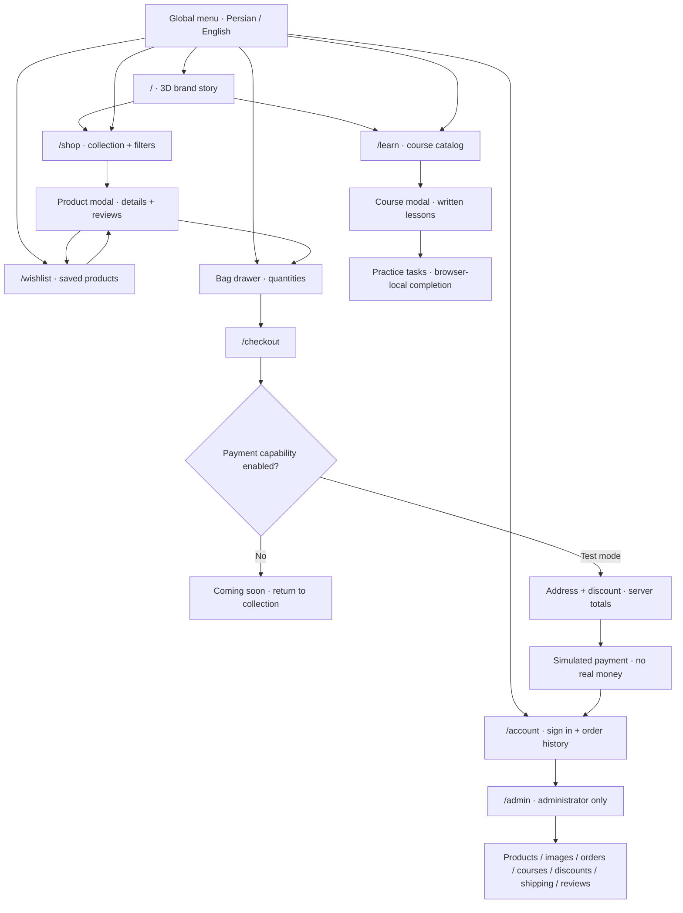
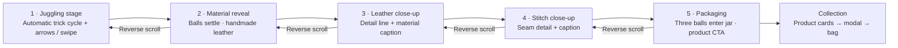

# JUG release review — 16 October 2026

The current application is a storefront prototype. A public showcase can launch before commerce; accepting real orders requires the payment and operations work below. “Present” means found in source, not a claim that every journey passed browser testing.

## Website graph

Product and course detail are modals, not dedicated shareable routes. Guests can prepare a cart; wishlist requires sign-in. Lesson progress is stored in the current browser, separated by user/course keys; it is not synchronized across devices.

## Animation and design flow

| Interaction | Present implementation | Remaining review / acceptance |
|---|---|---|
| Juggling | 3D leather models; timed pattern changes; arrows and swipe | Check low-power mobile devices, rapid switching and no WebGL |
| Chapter navigation | Wheel / touch snapping, next arrow, resize restoration | Check trackpad momentum, reverse mid-transition, mobile browser toolbar resizing and keyboard navigation |
| Material details | Camera/ball transformation, drawn callouts and animated text | Verify caption contrast, alignment and no overlap in both languages |
| Packaging | Forward/reverse timeline; CTA after ready state | Verify no trapped scroll or disappearing CTA after interruption |
| Ambient stage | Beams, halo, floor, grain and floating atmosphere | Measure GPU/frame cost; decide whether to simplify on mobile |
| Reduced motion | MotionConfig and reduced-motion branches | Verify the full journey remains reachable with OS setting enabled |
| Store feedback | Toast entrance/exit, product card styling, drawers/modals | Verify focus return, Escape, empty/loading/error states and touch targets |

Keep the dark theatrical stage, warm leather tones and restrained orange commerce actions. Proposed design work: a clear mobile path to products without completing the story; a static attractive model fallback; concise shipping/returns information near purchase; dedicated product pages if sharing/search is part of launch. These are proposals, not implemented changes.

## Prioritized remaining work

| ID | Priority | Task | Release acceptance |
|---|---|---|---|
| R01 | P0 commerce | Integrate real payment provider and verified callbacks | Server validates amount/order/provider result; retries cannot double-charge or double-decrement stock; failure/cancel/refund paths tested |
| R02 | P0 commerce | Confirm products, prices, stock, images and packaging claims | Owner signs off every sellable SKU and removes sample content |
| R03 | P0 commerce | Define fulfillment, shipping, returns and support | Published delivery regions/times/fees, refund policy and working support channel |
| R04 | P0 public | Fix navigation gaps | “Our story” currently targets #story, but homepage renders only hero; implement story section or remove that menu action |
| R05 | P0 public | Complete responsive + bilingual browser QA | Home chapters, menu, shop, lessons, account, wishlist and checkout at phone/tablet/desktop; Persian and English; no overflow or blocked controls |
| R06 | P0 commerce | Authentication and abuse review | Verify login/registration throttling, session handling, admin authorization and account recovery; define password reset/email verification |
| R07 | P0 public | Production operations | Error visibility, uptime checks, backup/restore rehearsal, rollback instructions and isolated preview data |
| R08 | P1 | Performance and motion accessibility | Measure load and frame behavior on real phones; verify reduced motion, keyboard and WebGL failure fallback |
| R09 | P1 | Product discovery and SEO | Decide dedicated product/course URLs; verify titles/canonicals on client navigation; add final social imagery and product metadata |
| R10 | P1 commerce | Customer communication | Order confirmation and shipping/status notifications with retry/error handling |
| R11 | P1 learning | Course scope decision | Choose free written lessons vs paid/video offering; confirm rights; add synchronized progress only if required |
| R12 | P1 growth | Analytics and conversion measurement | Approved analytics/privacy choice; measure hero→shop→bag→checkout with no personal data leakage |
| R13 | P2 scale | Normalize serialized database state | Load-test expected traffic first; migrate if locking/write contention exceeds the agreed target |

## Suggested release sequence

1. Showcase: resolve R04, R05, R07 and essential R08 checks; keep online ordering disabled. Confirm final copy/products.
2. Commerce: finish R01–R03, R06, R10 and end-to-end sandbox purchase/cancel/refund verification; enable real checkout only after those pass.
3. Growth: prioritize R09, R11, R12 and R13 using actual traffic and learning demand.

## Verification this session

- Frontend production build passed, including TypeScript checks and 12 generated pages.
- Backend `go test ./...` and `go vet ./...` passed.
- Juggling verifier passed all 144 handoffs, rapid switching, depth-lane separation, catches/releases and 16,595 airborne samples.
- Local PostgreSQL recovered and reported accepting connections on port 54329.
- Browser inspection confirmed the existing public 3D homepage renders. Complete multi-device/transaction QA remains open.
- No real payment, customer order, admin content edit, Git commit or Git push was performed during this review.

Deployment and HTTP smoke-check outcomes are recorded separately in the session handoff. This file maps the inspected working tree; later deployments/changes can make it stale.
